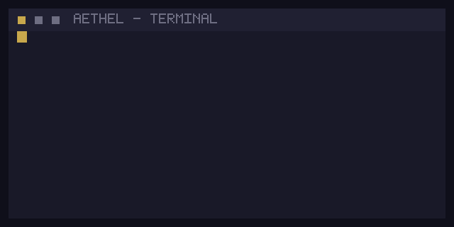

# AETHEL  REBORN

---

---

---

<table align="center" width="100%">
  <tr>
    <td width="50%" valign="top">
      <h3 align="center">About</h3>
      <pre align="center"><code>const aethelReborn = {
  name: 'Aethel Reborn',
  role: 'Full Stack Developer',
  stack: ['TypeScript', 'React', 'Node.js', 'Python', 'PostgreSQL', 'Docker'],
  focus: 'Scalable web systems',
  motto: 'Build. Learn. Ship.',
  openToWork: true,
};</code></pre>
      

        <b>Full Stack Developer</b> — building web applications that scale.
        Currently exploring dev tools, automation, and system design.
      

    </td>
    <td width="50%" valign="top">
      <h3 align="center">Tech Stack</h3>
      

        <b>Frontend</b> 
        
          
        <b>Backend & Database</b> 
        
          
        <b>Cloud & DevOps</b> 
        
          
        <b>Tools</b> 
        
      

    </td>
  </tr>
</table>

---

<h3 align="center">GitHub Stats</h3>

  
  

<h3 align="center">Activity</h3>

  

  
  

---

<h3 align="center">Featured</h3>

  

---

  

---

  <b>Full Stack Developer</b> — still building. 
  © 2026 Aethel Reborn

