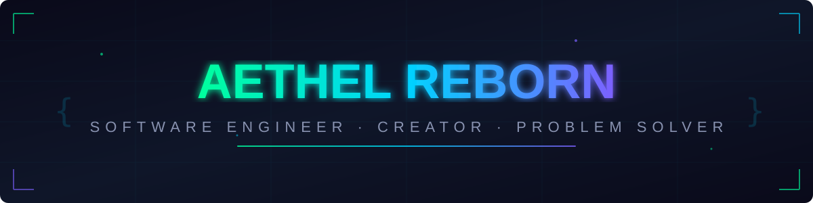
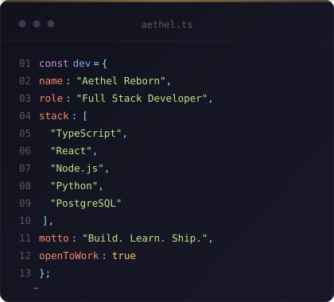

  

 

 

  

 

<table align="center" width="100%">
  <tr>
    <td width="45%" valign="top">
      
    </td>
    <td width="55%" valign="top">
      
        
      

        <b>Frontend</b> 
        
          
        <b>Backend & Database</b> 
        
          
        <b>Cloud & DevOps</b> 
        
          
        <b>Tools</b> 
        
      

    </td>
  </tr>
</table>

 

  

 

 

<table align="center" width="100%">
  <tr>
    <td width="50%" valign="top">
      

          
        
      

    </td>
    <td width="50%" valign="top">
      

          
        
      

    </td>
  </tr>
  <tr>
    <td width="50%" valign="top">
      

          
        
      

    </td>
    <td width="50%" valign="top">
      

          
        
      

    </td>
  </tr>
</table>

 

  

 

  

 

  
  &nbsp;&nbsp;
  

 

  

 

  

 

  

 

  

 

  

 

  

 

  © 2026 Aethel Reborn · Built with clean code and purpose

